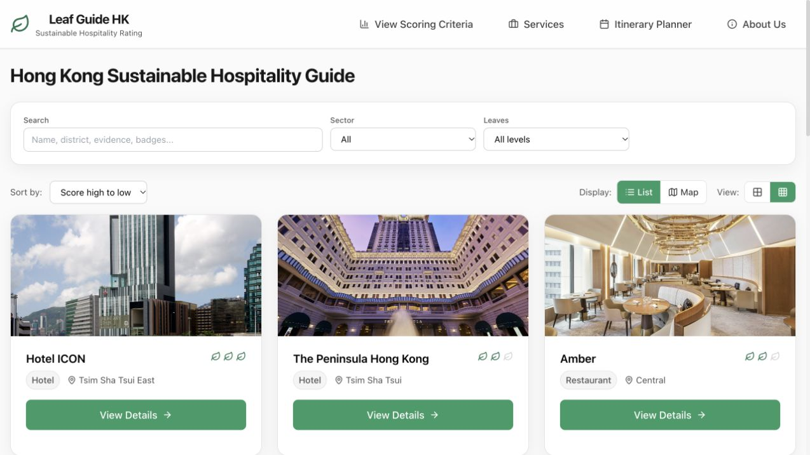

# 🌿 Leaf Guide HK

**A comprehensive sustainability guide for Hong Kong** — helping residents and visitors discover eco-friendly businesses, recycling locations, and water fountains across the city.



## 📋 Table of Contents

- [Overview](#overview)
- [Features](#features)
- [Tech Stack](#tech-stack)
- [Getting Started](#getting-started)
- [Project Structure](#project-structure)
- [Key Features](#key-features)
- [Data Sources](#data-sources)
- [Contributing](#contributing)

---

## 🌍 Overview

Leaf Guide HK is a React-based web application that promotes sustainable living in Hong Kong by providing:

- **Sustainability ratings** for hospitality businesses (hotels, restaurants, cafes, bakeries)
- **Interactive map** with 9,118 recycling locations across Hong Kong
- **426 water fountain locations** for refilling reusable bottles
- **Filterable directory** to find eco-friendly businesses
- **Itinerary planner** for sustainable tourism

The platform uses a **Leaf Rating System** (1-3 leaves) based on ten sustainability criteria, including governance, energy, waste management, and community impact.

---

## ✨ Features

### 🏢 Business Directory
- Browse 10 rated sustainable businesses
- Filter by sector (Hotel, Restaurant, Bakery, Cafe)
- Sort by sustainability score or leaf rating
- Detailed sustainability breakdowns with evidence

### 🗺️ Interactive Map
- **9,118 recycling locations** (public and private)
- **426 water fountains** across Hong Kong
- **Marker clustering** for performance with large datasets
- **Category filters** to show/hide different location types
- **Private recycling toggle** to include residential locations
- **Geographic bounds** locked to Hong Kong territory
- Zoom levels from 10 (full city) to 19 (street level)

### 📍 Location Features
- Real-time geolocation tracking
- District-based filtering
- Detailed popups with materials accepted
- Collection point type indicators
- Special notes for restricted access locations

### 🧭 Itinerary Planner
- Create custom sustainable travel routes
- Add businesses to your itinerary
- View locations on integrated map
- Export and share plans

---

## 🛠️ Tech Stack

### Frontend
- **React 18** - UI framework
- **Vite** - Build tool and dev server
- **React Router DOM** - Client-side routing
- **Tailwind CSS** - Utility-first styling

### Mapping
- **Leaflet** - Open-source mapping library
- **React-Leaflet** - React components for Leaflet
- **React-Leaflet-Cluster** - Marker clustering for performance
- **OpenStreetMap** - Map tile provider

### UI Components
- **Lucide React** - Icon library
- **clsx** - Conditional className utility

### Data
- **9,118 recycling locations** in the bundled location file
- **426 water fountains** in the bundled fountain file
- **10 sustainability-rated businesses** in the current directory

---

## 🚀 Getting Started

### Prerequisites
- Node.js 22.13+ and npm

### Installation

```bash
# Clone the repository
git clone https://github.com/Lavalx100/leaf-guide-hk.git
cd leaf-guide-hk

# Install dependencies
npm install

# Start development server
npm run dev
```

Open your browser to the local URL shown (typically `http://localhost:5173`)

### Quality checks

Run the same checks used by the GitHub Actions workflow:

```bash
npm test
npm run lint
npm run build
```

### Build for Production

```bash
npm run build
npm run preview
```

---

## 📁 Project Structure

```
leaf-guide-hk/
├── src/
│   ├── components/          # React components
│   │   ├── MapView.jsx     # Main interactive map component
│   │   ├── BusinessCard.jsx # Business listing cards
│   │   ├── Filters.jsx     # Filter controls
│   │   └── ...             # See src/components/README.md
│   ├── data/               # Data files
│   │   ├── recyclingLocations.js  # 9,118 recycling points
│   │   ├── waterFountains.js      # 426 water fountains
│   │   └── README.md
│   ├── utils/              # Utility functions
│   │   ├── locations.js    # Location helpers
│   │   ├── images.js       # Image utilities
│   │   └── README.md
│   ├── data.js             # Business data and criteria
│   ├── App.jsx             # Root component with routing
│   └── main.jsx            # React entry point
├── public/                 # Static assets
├── index.html              # HTML entry point
├── tailwind.config.js      # Tailwind configuration
├── vite.config.js          # Vite configuration
└── package.json            # Dependencies

```

📖 **Detailed documentation available in each folder's README.md**

---

## 🎯 Key Features

### Sustainability Scoring System

Businesses are evaluated across **10 criteria** (100 points total):

1. **Governance & public targets** (10 points)
2. **Legal readiness & risk** (10 points)
3. **Energy & carbon** (10 points)
4. **Water stewardship** (10 points)
5. **Waste & circularity** (10 points)
6. **Food & beverage sustainability** (10 points)
7. **Responsible sourcing & materials** (10 points)
8. **Community & biodiversity** (10 points)
9. **Guest engagement & transparency** (10 points)
10. **Recognition & certification** (10 points)

**Leaf Ratings:**
- 🌿 **1 Leaf**: 50-64 points (Foundational practices)
- 🌿🌿 **2 Leaves**: 65-79 points (Strong documented practices)
- 🌿🌿🌿 **3 Leaves**: 80-100 points (Excellent sustainability leadership)

### Map Controls

- **Category Filters**: Toggle hotels, restaurants, cafes, water fountains, recycling points
- **Private Recycling**: Show/hide private collection points (housing estates, offices)
- **Bounds Lock**: Map restricted to Hong Kong territory (22.15°-22.58°N, 113.82°-114.45°E)
- **Clustering**: Automatic grouping of nearby markers for performance

---

## 📊 Data Sources

### Recycling Locations
- **Total**: 9,118 bundled locations
- **Source**: Hong Kong Environmental Protection Department
- **Types**: Public bins, private collection points, NGO centers
- **Materials**: Paper, plastics, metals, glass, e-waste, food waste
- **Last Updated**: November 2025

### Water Fountains
- **Total**: 426 bundled locations
- **Coverage**: All 18 districts of Hong Kong
- **Types**: Public parks, government buildings, MTR stations

### Business Data
- **Manually curated** sustainability assessments
- **Evidence-based** scoring with source links
- Ten venues are currently included; assessments link to their published evidence sources.

---

## 🤝 Contributing

We welcome contributions! Please see our [Contributing Guidelines](CONTRIBUTING.md) for details.

### Adding New Businesses
1. Research the business's sustainability practices
2. Score against all 10 criteria using evidence
3. Add entry to `src/data.js` with sources
4. Submit pull request with documentation

### Reporting Data Issues
- Use GitHub Issues to report incorrect locations
- Include coordinates and description
- Tag with `data-quality` label

---

## 📝 Development Notes

### Performance Optimizations
- **Marker clustering** handles 9,000+ points without lag
- **Lazy loading** for map components
- **Memoization** of filtered data
- **Virtual scrolling** for large lists

### Browser Support
- Modern browsers (Chrome, Firefox, Safari, Edge)
- Mobile responsive design
- Touch-friendly map controls


---

## 🙏 Acknowledgments

- OpenStreetMap contributors for map data
- Hong Kong EPD for recycling location data
- Water Supplies Department for fountain locations
- All businesses participating in sustainability assessments

---

## 📧 Contact

For questions or suggestions:
- **GitHub Issues**: [Report bugs or request features](https://github.com/Lavalx100/leaf-guide-hk/issues)
- **Repository**: [github.com/Lavalx100/leaf-guide-hk](https://github.com/Lavalx100/leaf-guide-hk)

---

**Made with 🌿 for a sustainable Hong Kong**
